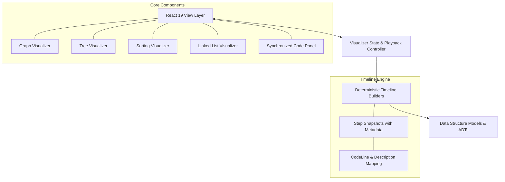

# Slide 3: System Architecture & Modern Tech Stack

## Slide Meta
- **Slide Number:** 3 of 7
- **Estimated Timing:** 1:30 min
- **Key Theme:** Software engineering design, clean separation of concerns, and toolchain

---

## Slide Content

### High-Level Architecture Overview

---

### Technology Stack & Justification

| Technology | Role | Justification |
| :--- | :--- | :--- |
| **React 19** | View & Component Framework | Fast declarative rendering, state management, and component modularity |
| **Vite 8** | Build Tool & Dev Server | Sub-second Hot Module Replacement (HMR) and optimized production bundles |
| **Tailwind CSS v4** | UI Styling System | High-performance CSS engine with bespoke dark-surface slate palette |
| **Framer Motion 12** | Animation & Physics Engine | Fluid layout transitions, spring physics for node drag-and-drop |
| **Lucide React** | Iconography System | Clean, accessible visual cues across control panels and navigation |
| **React Markdown / GFM** | Learning Engine | Dynamic rendering of algorithm explanations, formulas, and pseudocode |

---

### Architectural Highlights
- **Decoupled Timeline Architecture**: Algorithm logic is pure and detached from React render cycles. Algorithms generate an array of immutable step snapshots before playback begins.
- **Bi-Directional Time Scrubbing**: Storing discrete states guarantees $O(1)$ stepping backwards or forwards without re-running simulations or risking side-effects.

---

## Speaker Script / Talking Points
> "Now let's examine the system architecture under the hood. 
> 
> ALGOVIZ is built with a modern React 19 and Vite foundation, styled using Tailwind CSS v4 and powered by Framer Motion. 
> 
> The central engineering principle here is **Separation of Concerns**. Rather than tangling algorithm execution with React timers or component state, we built a dedicated **Deterministic Timeline Engine**. 
> When an algorithm runs, it executes purely against an Abstract Data Type model—such as `GraphModel` or `Vector`—and emits an array of immutable step snapshots. Each snapshot records which nodes are active, what values are comparing, and the exact source line of code. 
> 
> This architecture provides two enormous advantages: zero UI lag during intensive loops, and seamless bi-directional stepping. You can step forward, step backward, pause, or slide speed freely without state corruption."
